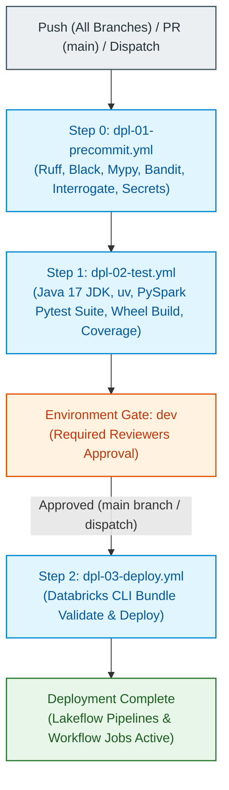
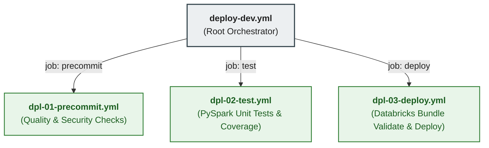

# GitHub Actions CI/CD Deployment Workflows

[](https://docs.github.com/en/actions)
[-FF3621?logo=databricks)](https://docs.databricks.com/dev-tools/bundles/index.html)
[](https://spark.apache.org/docs/latest/api/python/)
[-ED8B00?logo=openjdk)](https://adoptium.net/)
[](https://github.com/astral-sh/uv)
[](https://docs.pytest.org/)

---

## 1. Executive Summary

- **Purpose & Scope**:
  This directory contains the GitHub Actions automation pipelines powering continuous integration, automated testing, and continuous delivery for **Databricks Lakeflow Declarative Pipelines, Data Vault 2.0, Kimball Dimensional Data Warehouse (DWH), and Databricks Labs DQX Data Quality Framework**.
- **Three-Tier Modular Architecture**:
  The CI/CD pipeline decomposes execution into three decoupled, reusable stages:
  1. **Step 0 — Pre-commit Quality & Security Checks** ([`dpl-01-precommit.yml`](./dpl-01-precommit.yml)): Runs syntax hygiene, code formatting (Black), modern linting (Ruff), static typing (Mypy), security vulnerability scanning (Bandit), docstring coverage (Interrogate $\ge 95\%$), spelling, and YAML validation.
  2. **Step 1 — PySpark Unit Testing & Coverage** ([`dpl-02-test.yml`](./dpl-02-test.yml)): Configures Eclipse Temurin JDK 17 and an isolated `uv` virtual environment to execute the complete 9-suite PySpark unit test suite locally on ephemeral runners, verifies Python wheel build packaging (`uv build --wheel`), and exports code coverage reports.
  3. **Step 2 — Databricks Asset Bundle Deployment** ([`dpl-03-deploy.yml`](./dpl-03-deploy.yml)): Deploys the Python wheel artifact, Lakeflow Declarative Pipelines, and multi-task Databricks Workflows to target Databricks workspaces using the official Databricks CLI and OAuth Service Principal authentication, protected by GitHub Environment approval gates.
- **Root Orchestrator**:
  [`deploy-dev.yml`](./deploy-dev.yml) coordinates all three stages across pull requests, branch pushes, and authorized manual dispatches.
- **Why AWS Credentials Are NOT Required**:
  Unlike infrastructure provisioning repositories (such as `04_unity_catalog` where Terraform provisions AWS IAM roles, KMS keys, and S3 buckets directly via AWS APIs), this repository operates exclusively as a **Databricks Asset Bundle (DAB)**. The Databricks CLI communicates solely with the Databricks Workspace REST API (`https://<your-databricks-workspace-url>`). All underlying AWS storage and compute access is managed transparently by the Databricks Serverless control plane and Unity Catalog metastore storage credentials. Consequently, **no AWS IAM credentials, access keys, or STS tokens are needed in this CI/CD pipeline**.

---

## 2. Workflow Orchestration & Operational Flow

### 2.1 Pipeline Lifecycle & Flow



### 2.2 Trigger & Branching Strategy

| Event | Target Branches | Workflow | Pre-commit Phase | PySpark Testing Phase | Deployment Phase |
|:---|:---:|:---|:---:|:---:|:---:|
| `push` | Any branch (`**`) | `deploy-dev.yml` | **Yes** | **Yes** (9 Test Suites + Coverage) | **No** (Skipped on feature branches; executes on `main` under approval gates) |
| `pull_request` | `main` | `deploy-dev.yml` | **Yes** | **Yes** (Summary posted to Job Summary) | **No** (Gated; deployment executes upon PR merge to `main`) |
| `workflow_dispatch` | Selected branch | `deploy-dev.yml` | **Yes** | **Yes** | Runs if on `main` or if `auto_deploy: true` (gated by Environment Approval) |

---

## 3. Workflow Architecture & Reusable Modules



---

## 4. Workflow Inventory

| Workflow File | Trigger Type | Primary Role | Key Inputs / Defaults |
|:---|:---:|:---|:---|
| [`deploy-dev.yml`](./deploy-dev.yml) | `push`, `pull_request`, `workflow_dispatch` | Unified pipeline coordinating pre-commit checks, unit testing, and gated bundle deployment | `target: dev`, `auto_deploy: false` |
| [`dpl-01-precommit.yml`](./dpl-01-precommit.yml) | `workflow_call` | Runs linting, syntax formatting, static typing, and multi-engine security scans | `python_version: 3.10` |
| [`dpl-02-test.yml`](./dpl-02-test.yml) | `workflow_call` | Sets up Java 17 + uv, validates wheel building, and runs full PySpark test suite with coverage | `python_version: 3.10`, `java_version: 17` |
| [`dpl-03-deploy.yml`](./dpl-03-deploy.yml) | `workflow_call` | Configures Databricks CLI + uv, validates bundle schema, and deploys DAB resources under environment gates | `target: dev`, `environment: dev`, `databricks_cli_version: latest` |

---

## 5. Environment & Virtual Env Toolchain Plugins

To ensure rapid, deterministic, and isolated pipeline runs, official and hardened actions are employed:

| Plugin / Action | Source / Version | Purpose in Pipeline |
|:---|:---|:---|
| **Repository Checkout** | `actions/checkout@v7` | Checks out repository source code and commit history under minimal read permissions. |
| **Java JDK Setup** | `actions/setup-java@v4` | Installs Eclipse Temurin JDK 17 to provide the Java Virtual Machine runtime required by PySpark local driver execution. |
| **Python Package & Virtualenv Manager** | `astral-sh/setup-uv@v10.3.3` | High-performance Python package manager with lockfile (`uv.lock`) caching and native wheel builder (`uv build --wheel`). |
| **Pre-commit Environment Cache** | `actions/cache@v6` | Persists pre-commit hook virtual environments in `~/.cache/pre-commit` keyed by `.pre-commit-config.yaml`. |
| **Databricks CLI Setup** | `databricks/setup-cli@main` | Installs the modern Databricks CLI binary and exposes `databricks bundle validate` and `deploy` commands. |
| **Artifact Uploader** | `actions/upload-artifact@v4` | Uploads test coverage reports (`coverage.xml`) for inspection and audit retention. |

---

## 6. Required Secrets and Variables

Configure the following secrets in GitHub (**Settings** $\rightarrow$ **Secrets and variables** $\rightarrow$ **Actions**):

### 6.1 Databricks Platform Secrets

| Secret Name | Required | Description | Example / Format |
|:---|:---:|:---|:---|
| `DATABRICKS_HOST` | **Yes** | Workspace URL for the target environment | `https://<your-databricks-workspace-url>` |
| `DATABRICKS_ACCOUNT_ID` | **Yes** | Databricks Account ID (UUID format) | `<databricks-account-id>` |
| `DATABRICKS_CLIENT_ID` | **Yes** | OAuth Service Principal Application ID | `<service-principal-client-id>` |
| `DATABRICKS_CLIENT_SECRET` | **Yes** | OAuth Service Principal Secret | Sensitive OAuth secret string |
| `DATABRICKS_TOKEN` | Optional | Databricks Personal Access Token (PAT) as alternative auth | `dapi...` |

> [!NOTE]
> The workflows also support `DATABRICKS_SERVICE_PRINCIPAL_ID` and `DATABRICKS_SERVICE_PRINCIPAL_SECRET` as alternative secret names.

### 6.2 GitHub Environment Configuration

To enable manual review protection before applying bundle deployments to Databricks:
1. Navigate to **Settings** $\rightarrow$ **Environments** in your GitHub repository.
2. Click **New environment** and enter name: `dev`.
3. Under **Deployment protection rules**, enable **Required reviewers** and assign designated data platform engineers / reviewers.
4. (Optional) Under **Deployment branches**, restrict deployment to `main` only.

---

## 7. Local Developer Runbook

Before opening a pull request, run the exact same checks locally using `uv`:

```bash
# 1. Synchronize frozen dependencies
uv sync --frozen

# 2. Run all pre-commit hooks (formatting, linting, typing, security)
uv run pre-commit run --all-files

# 3. Verify wheel packaging
uv build --wheel

# 4. Run PySpark unit tests with coverage
uv run pytest -v --cov=src/python --cov-report=term-missing tests/

# 5. Validate Databricks Asset Bundle (DAB)
databricks bundle validate --target dev

# 6. Deploy bundle to dev workspace
databricks bundle deploy --target dev
```

---

## 8. Authoritative Links and Resources

### 8.1 Official Documentation
- [GitHub Actions Documentation](https://docs.github.com/en/actions) - Definitive guide for GitHub Actions workflows.
- [Databricks Asset Bundles (DAB)](https://docs.databricks.com/dev-tools/bundles/index.html) - Official Databricks bundles reference.
- [Databricks Setup CLI GitHub Action](https://github.com/databricks/setup-cli) - Official installer action for Databricks CLI.
- [Astral Setup uv Action](https://github.com/astral-sh/setup-uv) - Fast Python package and tool installer action.
- [Adoptium Eclipse Temurin Setup Java Action](https://github.com/actions/setup-java) - Official Java runtime installer action.
- [PySpark Documentation](https://spark.apache.org/docs/latest/api/python/) - PySpark API reference.

### 8.2 Internal References
- [Root Deployment Pipeline](./deploy-dev.yml)
- [Pre-commit Quality & Security Workflow](./dpl-01-precommit.yml)
- [PySpark Unit Testing & Coverage Workflow](./dpl-02-test.yml)
- [Databricks Asset Bundle Deployment Workflow](./dpl-03-deploy.yml)
- [Databricks Asset Bundle Manifest](../../databricks.yml)
- [PyProject Manifest](../../pyproject.toml)
- [Pre-commit Configuration](../../.pre-commit-config.yaml)
