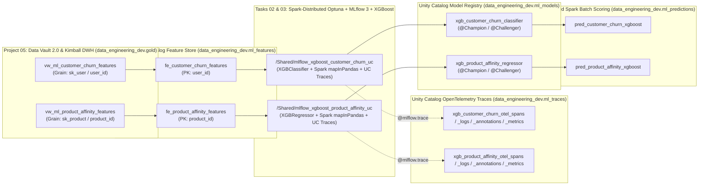

# Project Instructions & Engineering Blueprint (`INSTRUCTIONS.md`)

Project: **06 — Enterprise MLflow 3 & XGBoost Experimentation, Feature Store, UC OpenTelemetry Tracing & Model Governance on Databricks AWS**
Upstream Data Platform: **[`databricks_aws_deployment_05_data_vault_and_dwh`](https://github.com/MikolajSedek/databricks_aws_deployment_05_data_vault_and_dwh)**

---

## TOP PRIORITY: Mandatory Security Guardrails (Zero Secret Leakage)

> [!CAUTION]
> 1. **Zero Plaintext Credentials**: Never place Databricks Service Principal secrets (`DATABRICKS_CLIENT_SECRET`), Personal Access Tokens (`DATABRICKS_TOKEN`, `dapi...`), or AWS secret keys (`AWS_SECRET_ACCESS_KEY`, `AWS_SESSION_TOKEN`) in any code, notebook, YAML manifest, or MCP configuration file (`.mcp.json`, `.vscode/mcp.json`, `.cursor/mcp.json`).
> 2. **Documented Service Principal IDs**: Any Service Principal Client ID in `databricks.yml` or CI/CD workflows must include an explicit purpose comment stating that the secret is injected at runtime via `DATABRICKS_CLIENT_SECRET`.
> 3. **Mandatory Pre-Commit Scanning**: Run `detect-secrets`, `detect-aws-credentials`, and `bandit -c bandit.yaml` before committing any file.

---

## 1. Imperative Sources of Truth

1. **MLflow on Databricks (AWS)**: [`https://docs.databricks.com/aws/en/mlflow/`](https://docs.databricks.com/aws/en/mlflow/)
2. **Store OpenTelemetry Traces in Unity Catalog**: [`https://docs.databricks.com/aws/en/mlflow3/genai/tracing/trace-unity-catalog`](https://docs.databricks.com/aws/en/mlflow3/genai/tracing/trace-unity-catalog)
3. **Migrate Existing Traces to Unity Catalog**: [`https://docs.databricks.com/aws/en/mlflow3/genai/tracing/migrate-to-uc`](https://docs.databricks.com/aws/en/mlflow3/genai/tracing/migrate-to-uc)
4. **MLflow Python API Reference**: [`https://mlflow.org/docs/latest/api_reference/python_api/index.html`](https://mlflow.org/docs/latest/api_reference/python_api/index.html) (`mlflow.xgboost`, `mlflow.models`, `mlflow.pyfunc`, `mlflow.tracking`, `mlflow.tracing`)
5. **MLflow MCP Server (Open Source Reference)**: [`https://mlflow.org/docs/latest/genai/mcp/`](https://mlflow.org/docs/latest/genai/mcp/)
6. **Databricks MLflow 3 Tracing MCP Server**: [`https://docs.databricks.com/aws/en/mlflow3/genai/tracing/mlflow-mcp`](https://docs.databricks.com/aws/en/mlflow3/genai/tracing/mlflow-mcp)
7. **Databricks AI Dev Kit**: [`https://github.com/databricks-solutions/ai-dev-kit/tree/main`](https://github.com/databricks-solutions/ai-dev-kit/tree/main)
8. **Upstream Data Vault 2.0 & Kimball DWH Project**: [`https://github.com/MikolajSedek/databricks_aws_deployment_05_data_vault_and_dwh`](https://github.com/MikolajSedek/databricks_aws_deployment_05_data_vault_and_dwh)

---

## 2. Upstream Data Lineage (`05_data_vault_and_dwh` -> `06_mflow_experiment_project`)



---

## 3. Repository Structure

```text
├── apm.yml                                        # Agent Package Manager manifest
├── GEMINI.md                                      # Gemini developer & agent guidelines
├── INSTRUCTIONS.md                                # Detailed engineering & operational blueprint
├── README.md                                      # Project overview, architecture & runbook
├── databricks.yml                                 # Databricks Asset Bundle (4-task Serverless MLflow XGBoost workflow)
├── pyproject.toml                                 # Project dependencies (mlflow>=3.14.0, xgboost, optuna, click)
├── requirements.txt                               # Pinned development & runtime requirements
├── .pre-commit-config.yaml                        # Quality, typing, docstring & secret scanning hooks
├── .gemini/skills/                                # Authoritative Gemini agent skills
├── .github/
│   ├── copilot-instructions.md                    # GitHub Copilot instructions
│   ├── copilot/skills/                            # Mirrored Copilot agent skills
│   └── workflows/                                 # CI/CD pipelines (Pre-commit -> Pytest -> DAB Deploy)
├── src/
│   └── python/
│       ├── modules/
│       │   ├── utils/
│       │   │   ├── config.py                      # Immutable MLProjectConfig, feature lists, UC trace prefixes & FQNs
│       │   │   └── metadata.py                    # Column descriptions registry & DDL comment helpers
│       │   ├── features/
│       │   │   ├── feature_engineering.py         # Pure PySpark feature transforms (.withColumns) & UC Feature Store sync
│       │   │   └── synthetic_gold_views.py        # Explicit StructType contracts & deterministic sample Gold views
│       │   ├── training/
│       │   │   ├── spark_optuna.py                # Spark-distributed Optuna Ask-and-Tell + mapInPandas HPO engine
│       │   │   ├── xgboost_datasets.py            # Stratified/regression train-val-test splits & scale_pos_weight
│       │   │   └── xgboost_experiment.py          # Spark Optuna HPO + MLflow 3 XGBClassifier & XGBRegressor (@mlflow.trace)
│       │   ├── evaluation/
│       │   │   ├── model_governance.py            # LoggedModel registration & @Champion/@Challenger aliases
│       │   │   └── uc_tracing.py                  # Unity Catalog OpenTelemetry trace binding & legacy trace migration
│       │   └── inference/
│       │       └── batch_scoring.py               # Distributed Spark UDF (mlflow.pyfunc.spark_udf) & fe.score_batch
│       └── pipelines/
│           ├── prepare_uc_features.py             # Task 01 (Click): Provision schemas, migrate UC traces & sync Feature Tables
│           ├── train_churn_xgboost.py             # Task 02a (Click): Spark Optuna + MLflow 3 XGBClassifier training
│           ├── train_affinity_xgboost.py          # Task 02b (Click): Spark Optuna + MLflow 3 XGBRegressor training
│           └── batch_score_predictions.py         # Task 03 (Click): Distributed batch inference with @Champion models
└── tests/
    ├── conftest.py                                # Local PySpark session & isolated MLflow tracking fixture
    ├── modules/
    │   ├── utils/test_config_and_metadata.py      # Config FQNs, leak-free contracts & UC metadata DDLs
    │   ├── features/test_feature_engineering.py   # PySpark feature contracts, label spines & UC Feature Table sync
    │   ├── training/test_xgboost_datasets.py      # Temporal/fallback splits, scale_pos_weight & CI leakage guard
    │   ├── training/test_xgboost_experiments.py   # Spark Optuna mapInPandas, PyFunc serving & Spark UDF scoring
    │   ├── evaluation/test_model_governance.py    # Champion/Challenger promotion gates & synthetic blocking
    │   ├── evaluation/test_uc_tracing.py          # Unity Catalog OpenTelemetry trace binding & migration
    │   └── inference/test_batch_scoring.py        # Strict alias resolution, warning filters & prediction formatting
    └── pipelines/
        └── test_pipeline_entrypoints.py           # Fail-fast missing-table/leakage guards & Click CLI entrypoints
```

---

## 4. MLflow MCP Server Configuration (`mlflow-mcp`)

To enable AI assistants (Gemini CLI, Claude Code, Cursor, VS Code) to query and analyze `@mlflow.trace` spans recorded during XGBoost experiments on Databricks:

1. Ensure `mlflow[databricks,mcp]>=3.14.0` is installed (`uv sync --extra dev`).
2. Configure your MCP client (e.g., `.mcp.json` or IDE MCP settings) using runtime environment variables (never hardcode tokens):
   ```json
   {
     "mcpServers": {
       "mlflow-mcp": {
         "command": "uv",
         "args": [
           "run",
           "--with",
           "mlflow[databricks,mcp]>=3.14.0",
           "mlflow",
           "mcp",
           "run"
         ],
         "env": {
           "MLFLOW_TRACKING_URI": "databricks"
         }
       }
     }
   }
   ```
3. Set `DATABRICKS_HOST` and OAuth Service Principal credentials (`DATABRICKS_CLIENT_ID`, `DATABRICKS_CLIENT_SECRET`) or `DATABRICKS_CONFIG_PROFILE=dev` in your shell environment.
