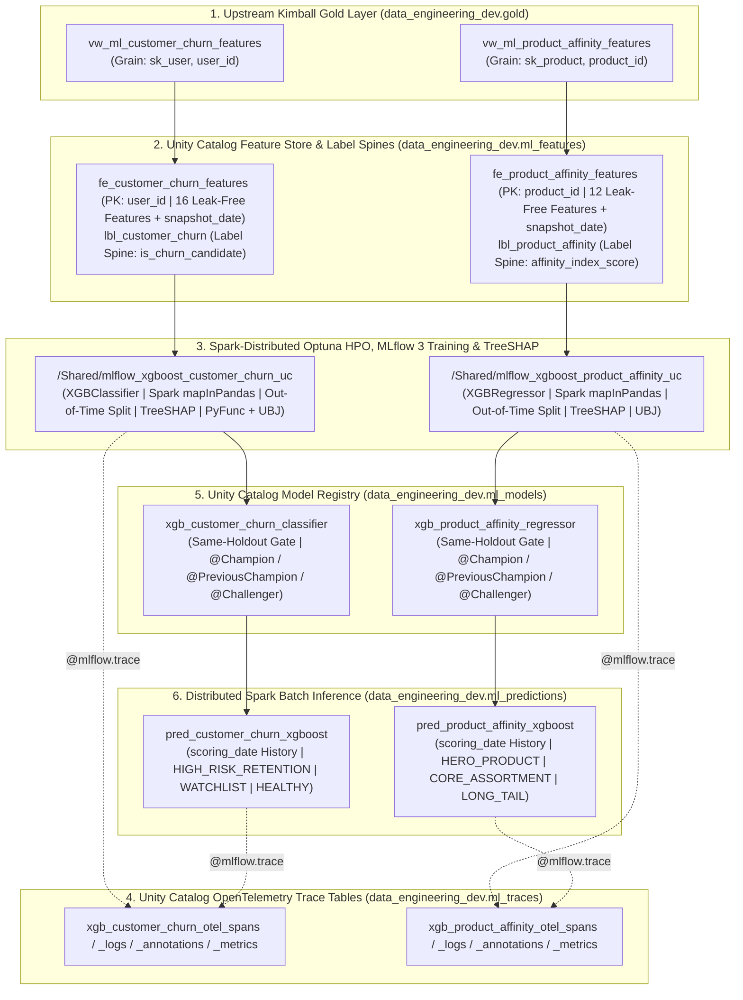

# Enterprise MLflow 3, XGBoost & SHAP Experimentation, Feature Store, UC OpenTelemetry Tracing & Model Governance on Databricks AWS

An end-to-end **MLflow 3 (`>=3.14.0`)**, **XGBoost**, **SHAP (`TreeExplainer`)**, **Spark-Distributed Optuna**, **Unity Catalog Feature Store**, and **Unity Catalog OpenTelemetry Trace Governance** platform on Databricks AWS. This project consumes governed Gold Kimball Star Schema views produced by **[Project 05 (`databricks_aws_deployment_05_data_vault_and_dwh`)](https://github.com/MikolajSedek/databricks_aws_deployment_05_data_vault_and_dwh)** in catalog `data_engineering_dev` and operationalizes two production machine learning domains:

1. **Customer Churn Classification (`XGBClassifier`)** — Predicts customer churn propensity (`predicted_churn_probability`, `predicted_churn_label`) via a probability-emitting MLflow `PyFunc` wrapper (`ChurnProbabilityPyFuncModel`) with validation-calibrated decision thresholds and assigns actionable retention tiers (`HIGH_RISK_RETENTION`, `WATCHLIST`, `HEALTHY`).
2. **Product Affinity Regression (`XGBRegressor`)** — Predicts continuous product affinity index scores (`predicted_affinity_score`, `affinity_residual`) and assigns merchandising assortment tiers (`HERO_PRODUCT`, `CORE_ASSORTMENT`, `LONG_TAIL`).

---

## 1. End-to-End Architecture



---

## 2. Unity Catalog 3-Level Namespace Inventory (`data_engineering_dev`)

| Layer | Unity Catalog Schema | Governed Asset Name | Asset Type | Primary Key / Alias / Prefix |
| :--- | :--- | :--- | :--- | :--- |
| **Upstream Kimball Gold** | `data_engineering_dev.gold` | `vw_ml_customer_churn_features` | View | `sk_user`, `user_id` |
| **Upstream Kimball Gold** | `data_engineering_dev.gold` | `vw_ml_product_affinity_features` | View | `sk_product`, `product_id` |
| **UC Feature Store** | `data_engineering_dev.ml_features` | `fe_customer_churn_features` | Managed Delta (Label-Free Feature Table) | PK: `user_id` (`snapshot_date`) |
| **UC Feature Store** | `data_engineering_dev.ml_features` | `fe_product_affinity_features` | Managed Delta (Label-Free Feature Table) | PK: `product_id` (`snapshot_date`) |
| **UC Label Spines** | `data_engineering_dev.ml_features` | `lbl_customer_churn` | Managed Delta (Target Label Spine) | `user_id`, `snapshot_date`, `is_churn_candidate` |
| **UC Label Spines** | `data_engineering_dev.ml_features` | `lbl_product_affinity` | Managed Delta (Target Label Spine) | `product_id`, `snapshot_date`, `affinity_index_score` |
| **UC Model Registry** | `data_engineering_dev.ml_models` | `xgb_customer_churn_classifier` | MLflow 3 `LoggedModel` (PyFunc + `ubj`) | `@Champion`, `@PreviousChampion`, `@Challenger` |
| **UC Model Registry** | `data_engineering_dev.ml_models` | `xgb_product_affinity_regressor` | MLflow 3 `LoggedModel` (`ubj`) | `@Champion`, `@PreviousChampion`, `@Challenger` |
| **UC OTel Trace Store** | `data_engineering_dev.ml_traces` | `xgb_customer_churn_otel_*` | Managed Delta (OTel Spans/Logs) | Prefix: `xgb_customer_churn` |
| **UC OTel Trace Store** | `data_engineering_dev.ml_traces` | `xgb_product_affinity_otel_*` | Managed Delta (OTel Spans/Logs) | Prefix: `xgb_product_affinity` |
| **Batch Predictions** | `data_engineering_dev.ml_predictions` | `pred_customer_churn_xgboost` | Managed Delta (Partitioned by `scoring_date`) | `sk_user`, `user_id`, `scoring_date` |
| **Batch Predictions** | `data_engineering_dev.ml_predictions` | `pred_product_affinity_xgboost` | Managed Delta (Partitioned by `scoring_date`) | `sk_product`, `product_id`, `scoring_date` |

---

## 3. Repository Structure

```text
06_mflow_experiment_project/
├── .github/workflows/
│   ├── deploy-dev.yml                       # End-to-end CI/CD orchestration (Pre-commit -> Pytest -> DAB Deploy)
│   ├── dpl-01-precommit.yml                 # Reusable quality, typing, docstring & secret-scanning workflow
│   ├── dpl-02-test.yml                      # Reusable Java 17 + parallel pytest-xdist PySpark/MLflow 3 test workflow
│   └── dpl-03-deploy.yml                    # Reusable Databricks Asset Bundle validation & deployment workflow
├── .gemini/skills/                          # Authoritative Databricks, MLflow 3, XGBoost & Functional PySpark skills
├── src/python/
│   ├── modules/
│   │   ├── evaluation/
│   │   │   ├── model_governance.py          # Same-holdout @Champion/@Challenger promotion, mlflow.evaluate & FI logs
│   │   │   ├── shap_explainability.py       # TreeSHAP attributions, summary/bar/waterfall plots & MLflow artifact logs
│   │   │   └── uc_tracing.py                # Unity Catalog OpenTelemetry trace binding & idempotent trace migration
│   │   ├── features/
│   │   │   ├── feature_engineering.py       # Pure functional PySpark feature engineering & label spine separation
│   │   │   └── synthetic_gold_views.py      # Explicit StructType contracts & deterministic sample Gold view builders
│   │   ├── inference/
│   │   │   └── batch_scoring.py             # Distributed spark_udf / FeatureStore scoring & scoring_date Delta history
│   │   ├── training/
│   │   │   ├── spark_optuna.py              # Spark Ask-and-Tell + mapInPandas HPO, early stopping & threshold tuning
│   │   │   ├── xgboost_datasets.py          # Out-of-time/stratified splits, leakage stump guard & feature importance
│   │   │   └── xgboost_experiment.py        # MLflow 3 + XGBClassifier/XGBRegressor lifecycle, PyFunc wrapper & UBJ logs
│   │   └── utils/
│   │       ├── config.py                    # Immutable MLProjectConfig dataclass & leak-free feature contracts
│   │       └── metadata.py                  # Unity Catalog column comment registry & schema provisioning DDLs
│   └── pipelines/
│       ├── prepare_uc_features.py           # Task 1 (Click CLI): Provision schemas, sync Feature Tables & Label Spines
│       ├── training_runner.py               # Shared domain training orchestrator (join, leakage guard, HPO, governance)
│       ├── train_churn_xgboost.py           # Task 2a (Click CLI): Customer Churn XGBClassifier training & UC promotion
│       ├── train_affinity_xgboost.py        # Task 2b (Click CLI): Product Affinity XGBRegressor training & UC promotion
│       └── batch_score_predictions.py       # Task 3 (Click CLI): Distributed Spark batch scoring of @Champion models
├── tests/
│   ├── conftest.py                          # Worker-isolated SparkSession, cloned MLflow 3 SQLite & xdist loadgroup hooks
│   ├── modules/
│   │   ├── utils/test_config_and_metadata.py        # Config FQNs, leak-free contracts & UC metadata DDLs
│   │   ├── features/test_feature_engineering.py     # PySpark feature contracts, label spines & UC Feature Table sync
│   │   ├── training/test_xgboost_datasets.py        # Temporal/fallback splits, scale_pos_weight & CI leakage guard
│   │   ├── training/test_xgboost_experiments.py     # Spark Optuna mapInPandas, PyFunc serving & Spark UDF scoring
│   │   ├── evaluation/test_model_governance.py      # Champion/Challenger promotion gates & synthetic blocking
│   │   ├── evaluation/test_shap_explainability.py   # TreeSHAP tabular/plot artifact logging & edge-case checks
│   │   ├── evaluation/test_uc_tracing.py            # Unity Catalog OpenTelemetry trace binding & migration
│   │   └── inference/test_batch_scoring.py          # Strict alias resolution, warning filters & historical Delta writes
│   └── pipelines/
│       └── test_pipeline_entrypoints.py             # Fail-fast missing-table/leakage guards & Click CLI entrypoints
├── databricks.yml                           # Databricks Asset Bundle (Serverless v4 multi-task wheel workflow)
├── pyproject.toml                           # Project metadata, wheel entrypoints, dependencies & quality tool configs
└── GEMINI.md                                # Architectural guardrails, zero-secret-leakage rules & developer standards
```

---

## 4. Key Architectural Capabilities

### 4.1 Leak-Free Functional PySpark Feature Engineering & Label Spines (`feature_engineering.py`, `config.py`)
- Built according to **Palantir PySpark** and **Mikołaj Sędek Functional Data Engineering** standards:
  - **Tier 1 (`Column -> Column`)**: Pure column expression builders (`safe_ratio`, `encode_loyalty_tier`, `encode_customer_segment`, `encode_product_category`, `bucket_high_cardinality_code`).
  - **Tier 2 (`DataFrame -> DataFrame`)**: Composable transformations (`engineer_customer_churn_features`, `engineer_product_affinity_features`) using single-projection `.withColumns({...})`, explicit `.select(*CONTRACT)` schema enforcement, and zero chained `.withColumn()` loops.
- **Label Separation & Leakage Prevention**:
  - Feature tables (`fe_customer_churn_features` with **16 features**, `fe_product_affinity_features` with **12 features**) are strictly label-free and carry `snapshot_date` for point-in-time joins; targets live in separate label spines (`lbl_customer_churn`, `lbl_product_affinity`).
  - Upstream deterministic formula inputs (`LEAKY_CHURN_COLUMNS`, `LEAKY_AFFINITY_COLUMNS`) are stripped before training, and `detect_single_feature_leakage()` fits depth-1 decision stumps as a fail-fast runtime and CI guard.
  - Attaches governed Unity Catalog column comments in a single projection via `attach_column_descriptions`.

### 4.2 Spark-Distributed Optuna HPO & Out-of-Time Training (`spark_optuna.py`, `xgboost_datasets.py`, `xgboost_experiment.py`)
- **Out-of-Time Temporal Splitting**: Automatically partitions train/validation/holdout chronologically by `snapshot_date` when ≥ 3 periods exist (preventing future leakage), with deterministic stratified/random fallback when only a single snapshot is available.
- **Spark Ask-and-Tell HPO**: Pairs Optuna's `study.ask()` / `study.tell()` (`TPESampler`) with PySpark's **`DataFrame.mapInPandas`** (100% compatible with Databricks Serverless Spark Connect, zero legacy RDD calls):
  - Evaluates parallel waves of size `spark_parallelism` (default `4`) with per-worker CPU capping (`worker_n_jobs=1`) to prevent thread oversubscription.
  - Applies validation early stopping (`early_stopping_rounds=30`) and refits the final candidate on `Train + Val` using the 0-indexed `best_iteration + 1` (clamped to `>= 10` trees).
- **Leak-Free Calibration & Serving Wrapper**:
  - Calibrates the optimal binary classification F1 threshold strictly on `X_val` (never `X_test`) and stores it in MLflow run params/tags.
  - Wraps the churn `XGBClassifier` in `ChurnProbabilityPyFuncModel` (backed by a UBJSON `model.ubj` artifact) so `mlflow.pyfunc.spark_udf` and `mlflow.evaluate()` consistently receive continuous positive-class probabilities in `[0.0, 1.0]`.

### 4.3 Model Explainability with SHAP (`shap_explainability.py`)
- Computes exact `shap.TreeExplainer` attributions on holdout evaluation samples (capped to a configurable sample size for fast serverless execution) and logs a full explainability bundle under `explainability/` on the final MLflow 3 run:
  - **Tabular Artifacts**: `shap_feature_importance.csv`, `shap_feature_importance.json`, and `shap_values_sample.csv` (with `shap_base_value` and `shap_<feature>` columns).
  - **Visual Diagnostics** (rendered via headless matplotlib `Agg` backend): `shap_summary_beeswarm.png`, `shap_summary_bar.png`, and `shap_waterfall_top_instance.png` (explaining the highest-impact prediction).
  - **Tracked Metrics**: Logs top feature mean absolute SHAP impacts (`shap_mean_abs_<feature>`) directly to MLflow for cross-run drift comparison.

### 4.4 Unity Catalog OpenTelemetry Trace Storage & Migration (`uc_tracing.py`)
- Implements the official Databricks [Store traces in Unity Catalog](https://docs.databricks.com/aws/en/mlflow3/genai/tracing/trace-unity-catalog) and [Migrate existing traces to Unity Catalog](https://docs.databricks.com/aws/en/mlflow3/genai/tracing/migrate-to-uc) workflows:
  - Binds MLflow 3 experiments (`/Shared/mlflow_xgboost_customer_churn_uc` and `/Shared/mlflow_xgboost_product_affinity_uc`) to `mlflow.entities.trace_location.UnityCatalog(catalog_name="data_engineering_dev", schema_name="ml_traces", table_prefix=...)`.
  - Automatically writes OpenTelemetry spans, logs, annotations, and metrics to governed Unity Catalog Delta tables (`*_otel_spans`, `*_otel_logs`, `*_otel_annotations`, `*_otel_metrics`).
  - Supports opt-in, idempotent migration from legacy experiments via `--migrate-uc-traces` (guarded by experiment-level migration tags).

### 4.5 Unity Catalog `@Champion` / `@Challenger` Governance (`model_governance.py`)
- Evaluates final candidate models on the untouched holdout set via `mlflow.evaluate()` and logs feature importance artifacts.
- **Same-Holdout Champion Comparison**: When an incumbent `@Champion` exists, re-evaluates it on the *identical* holdout split (with automatic fallback to stored run metrics if unavailable) and enforces minimum quality gates (`min_churn_roc_auc=0.70`, `min_affinity_r2=0.60`) plus minimum improvement margins (`min_churn_roc_auc_delta=0.005`, `min_affinity_r2_delta=0.005`).
- **Synthetic Data Promotion Guard**: Blocks `@Champion` promotion whenever `is_synthetic_data=True` so local/dev synthetic runs can never overwrite a production champion.
- Promotes passing winners to `@Champion` (demoting the prior champion to `@PreviousChampion`) and tags non-winning versions as `@Challenger`.

### 4.6 Historical Distributed Batch Scoring (`batch_scoring.py`)
- Strictly resolves `models:/<catalog>.<model_schema>.<model>@Champion` by default (failing fast if `@Champion` is missing unless `--allow-challenger-fallback` is explicitly passed for dev/test).
- Persists predictions partitioned by ISO `scoring_date` using Delta `replaceWhere` (idempotent daily re-runs preserving historical snapshots) or `append` mode.

---

## 5. Click CLI Pipeline Entrypoints

All 4 pipeline scripts use `click` with `context_settings={"ignore_unknown_options": True, "allow_extra_args": True}` and are also registered as wheel console scripts (`prepare-uc-features`, `train-churn-xgboost`, `train-affinity-xgboost`, `batch-score-predictions`) for both local execution and Databricks Serverless `python_wheel_task` jobs:

```bash
# Task 1: Provision Unity Catalog ML schemas, sync Feature Tables & Label Spines (optional one-off trace migration)
uv run python -m src.python.pipelines.prepare_uc_features \
  --catalog data_engineering_dev \
  --gold-schema gold \
  --feature-schema ml_features \
  --model-schema ml_models \
  --predictions-schema ml_predictions \
  --trace-schema ml_traces \
  --no-migrate-uc-traces

# Task 2a: Train Customer Churn XGBClassifier with Spark Optuna, TreeSHAP & UC Governance
uv run python -m src.python.pipelines.train_churn_xgboost \
  --catalog data_engineering_dev \
  --optuna-trials 10 \
  --spark-parallelism 4 \
  --worker-n-jobs 1 \
  --early-stopping-rounds 30 \
  --min-roc-auc 0.70 \
  --strict-leakage-check \
  --log-shap-artifacts

# Task 2b: Train Product Affinity XGBRegressor with Spark Optuna, TreeSHAP & UC Governance
uv run python -m src.python.pipelines.train_affinity_xgboost \
  --catalog data_engineering_dev \
  --optuna-trials 10 \
  --spark-parallelism 4 \
  --worker-n-jobs 1 \
  --early-stopping-rounds 30 \
  --min-r2 0.60 \
  --strict-leakage-check \
  --log-shap-artifacts

# Task 3: Distributed Spark Batch Scoring with @Champion Models & scoring_date Delta history
uv run python -m src.python.pipelines.batch_score_predictions \
  --catalog data_engineering_dev \
  --alias Champion \
  --write-mode replace_where
```

> **Dev/Test flags**: Pass `--allow-synthetic` to seed deterministic sample data when upstream Project 05 tables are absent, and `--allow-challenger-fallback` during scoring to permit falling back from `@Champion` to `@Challenger`. Both default to `False` for production safety.

---

## 6. Local Development, Testing & Quality Gates

### 6.1 Parallel Testing Architecture (`pytest-xdist` + `--dist=loadgroup`)

The 89-test suite is designed for **process-level parallelism** via `pytest-xdist` (`-n 4 --dist=loadgroup`), isolating global MLflow tracking/tracing state, matplotlib figures, mocks, and Spark JVMs across workers while keeping Spark JVM memory bounded:

| `xdist_group` | Tests | Spark JVMs | Purpose |
| :--- | :---: | :---: | :--- |
| `@non_spark` (default) | 67 | 0 | Pure Python unit tests (61) + isolated MLflow 3 SQLite tests (6) |
| `@spark_unit` | 20 | 1 | Feature engineering, datasets, scoring, metadata & leakage Spark unit tests sharing one local JVM |
| `@spark_churn_e2e` | 1 | 1 | Customer Churn Spark Optuna + TreeSHAP + PyFunc + Spark UDF E2E test |
| `@spark_affinity_e2e` | 1 | 1 | Product Affinity Spark Optuna + TreeSHAP + UBJ + Spark UDF E2E test |

**Key isolation & speed optimizations in [`tests/conftest.py`](tests/conftest.py):**
- **Bounded Spark Isolation**: Each Spark worker initializes a dedicated `local[1]` JVM (`spark.driver.memory=1g`) with worker-scoped `spark.sql.warehouse.dir` and `spark.local.dir` under `tmp_path_factory`.
- **Pre-Migrated MLflow 3 SQLite Template**: Alembic tracking and registry migrations execute once per worker (`_mlflow_template_db`) and are atomically cloned per test via `sqlite3.Connection.backup()`.
- **Default Tracing Suppression**: `_isolate_mlflow_tracing_by_default` keeps MLflow tracing disabled for non-MLflow tests so traced helpers never write to `./mlflow.db` in the repo root or trigger cross-worker SQLite lock contention.
- **Registered Pytest Markers** (`pyproject.toml`): `spark`, `mlflow`, and `slow` allow fast targeted subsets during local iteration.

### 6.2 Running Tests & Quality Gates

```bash
# 1. Synchronize virtual environment with all runtime & dev dependencies
uv sync --extra dev

# 2a. Full parallel test suite with bounded Spark JVMs & coverage (89 tests, matches CI in dpl-02-test.yml)
uv run pytest -n 4 --dist=loadgroup --cov=src/python --cov-report=term-missing tests/

# 2b. Fast non-Spark test suite (67 tests, ~22s, zero JVM startup; run single-process to avoid worker boot overhead)
uv run pytest -m "not spark"

# 2c. Ultra-fast pure Python unit tests (61 tests, ~4.5s, ideal for tight inner-loop development)
uv run pytest -m "not spark and not mlflow"

# 3. Run static analysis, formatting, strict typing, security, secret & docstring checks
uv run ruff check src/python tests
uv run black --check --line-length=120 src/python tests
uv run mypy src/python tests
uv run bandit -c bandit.yaml -r src/python -ll -ii
uv run bandit -c bandit.yaml -r src/python tests -t B105,B106,B107 -l
uv run interrogate -v --fail-under 95 src/python
uv run codespell src/python tests README.md databricks.yml
uv run yamllint -c .yamllint.yml databricks.yml .pre-commit-config.yaml bandit.yaml
uv run detect-secrets scan --exclude-files '(uv\.lock|apm\.lock\.yaml|\.venv|\.secrets\.baseline)'
```

---

## 7. Deploying & Running on Databricks Serverless via Asset Bundles (DAB)

The 4-task workflow (`mlflow_xgboost_end_to_end_workflow`) in [`databricks.yml`](databricks.yml) builds a Python wheel via `uv build --wheel` and runs on cost-optimized Databricks Serverless Standard compute (`performance_target: STANDARD`, `environment_version: "4"`, `disable_auto_optimization: true`) with dynamic `trace_warehouse_id` lookup and zero hardcoded credentials (CI/CD injects `DATABRICKS_HOST` / OAuth Service Principal credentials exclusively via GitHub Actions Secrets in [`.github/workflows/dpl-03-deploy.yml`](.github/workflows/dpl-03-deploy.yml)):

```bash
# Validate bundle configuration & wheel build spec
databricks bundle validate --target dev

# Build Python wheel artifact and deploy workflow to Databricks workspace
databricks bundle deploy --target dev

# Trigger and monitor the 4-task end-to-end MLflow 3, XGBoost & SHAP workflow
databricks bundle run mlflow_xgboost_end_to_end_workflow --target dev
```

---

## 8. Imperative Sources of Truth

- [Databricks MLflow 3 Documentation](https://docs.databricks.com/aws/en/mlflow/)
- [Store OpenTelemetry Traces in Unity Catalog](https://docs.databricks.com/aws/en/mlflow3/genai/tracing/trace-unity-catalog)
- [Migrate Existing Traces to Unity Catalog](https://docs.databricks.com/aws/en/mlflow3/genai/tracing/migrate-to-uc)
- [Databricks MLflow 3 Tracing & MCP Server](https://docs.databricks.com/aws/en/mlflow3/genai/tracing/mlflow-mcp)
- [MLflow Python API Reference (`mlflow.xgboost`)](https://mlflow.org/docs/latest/api_reference/python_api/index.html)
- [SHAP Documentation (`shap.TreeExplainer`)](https://shap.readthedocs.io/en/latest/)
- [MLflow MCP Server Documentation](https://mlflow.org/docs/latest/genai/mcp/)
- [Databricks AI Dev Kit](https://github.com/databricks-solutions/ai-dev-kit/tree/main)
- [Project 05: Data Vault 2.0 & Kimball Dimensional DWH](https://github.com/MikolajSedek/databricks_aws_deployment_05_data_vault_and_dwh)
